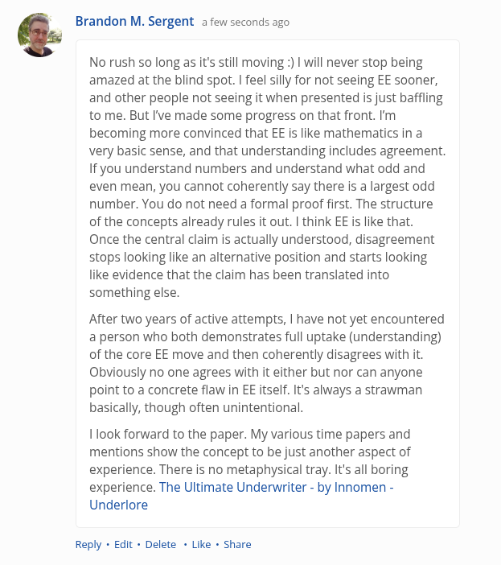

# EE Segment transcript

## Machine transcription

" Brandon M. Sergent a few seconds ago

No rush so long as it's still moving :) | will never stop being
amazed at the blind spot. | feel silly for not seeing EE sooner,
and other people not seeing it when presented is just baffling
to me. But I've made some progress on that front. I'm
becoming more convinced that EE is like mathematics in a
very basic sense, and that understanding includes agreement
If you understand numbers and understand what odd and
even mean, you cannot coherently say there is a largest odd
number. You do not need a formal proof first. The structure
of the concepts already rules it out. | think EE is like that.
Once the central claim is actually understood, disagreement
stops looking like an alternative position and starts looking
like evidence that the claim has been translated into
something else.

After two years of active attempts, | have not yet encountered
a person who both demonstrates full uptake (understanding)
of the core EE move and then coherently disagrees with it
Obviously no one agrees with it either but nor can anyone
point to a concrete flaw in EE itself. It's always a strawman
basically, though often unintentional.

ook forward to the paper. My various time papers and
mentions show the concept to be just another aspect of
experience. There i no metaphysical tray. Its all boring
experience. The Ultimate Underwriter - by Innomen -
Underlore

Reply - Edit - Delete - Like « Share
