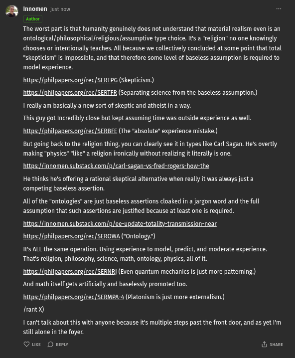

# EE Segment transcript

## Machine transcription

Innomen Justrow
nuthor

The worst part is that humanity genuinely does not understand that material realism even s an

ontological/philosophical  eligious assumptive type choice. It a "religion" no one knowingly

chooses or intentionally teaches. All because we collectively concluded at some point that total

“skepticism" is impossible, and that therefore some level of baseless assumption is required to

model experience.

ttps://philpapers.ore/rec/ SERTPG (Skepticism.)
https://philpapers.org/rec/SERTER (separating science from the baseless assumption.)

1 really am basically a new sort of skeptic and atheist in a way.

g
ers.orgrec/ SERBEE (The "absolute" experience mistake)

This guy got Incredibly close but kept assu
‘https://pl
But going back to the religion thing, you can clearly see it in types ke Carl Sagan. He's overtly
‘making "physics" "like" a rligion ionically without realzing it iterally s one.
hitps://innomen substack.com/p/carl-sagan-vsfred-rogers-how-the

He thinks he's offering a rational skeptical alternative when really it was always just a
competing baseless assertion.

e was outside experience as well.

Al of the "ontologies” are just baseless assertions cloaked in a jargon word and the full
assumption that stich assertions are justified because at least one s required.

https://innomen.substack.com/p/ee-update-totality-transmission-near
https://philpapers.org/rec/SEROWA (*Ontology:)

Its ALL the same operation. Using experience to model, predict, and moderate experience.
That's religion, philosophy, science, math, ontology, physics, all of it

‘ttps://philg
And math itself gets a
rg/rec/SERMPA-4 (Platonism is just more externalism.)

ers.orgrec/SERN) (Even quantum mechanics is just more patterning)

ally and baselessly promoted too.
https://philpapers
Irant X)

1 can't talk about this with anyone because it's multiple steps past the front door, and as yet I'm
still alone in the foyer.

Qe D ey & swane
