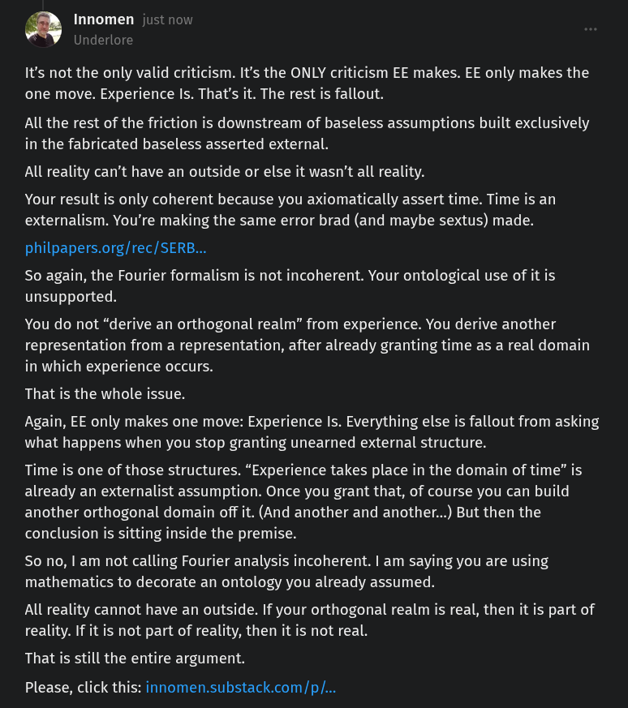

# EE Segment transcript

## Machine transcription

Innomen just now

Underlore
It's not the only valid criticism. It's the ONLY criticism EE makes. EE only makes the
one move. Experience Is. That's it. The rest is fallout.

All the rest of the friction is downstream of baseless assumptions built exclusively
in the fabricated baseless asserted external.

All reality can’t have an outside or else it wasn't all reality.

Your result is only coherent because you axiomatically assert time. Time is an
externalism. You're making the same error brad (and maybe sextus) made.

philpapers.org/rec/SERB...

So again, the Fourier formalism is not incoherent. Your ontological use of it is
unsupported.

You do not “derive an orthogonal realm” from experience. You derive another
representation from a representation, after already granting time as a real domain
in which experience occurs.

That is the whole issue.

Again, EE only makes one move: Experience Is. Everything else is fallout from asking
what happens when you stop granting unearned external structure.

Time is one of those structures. “Experience takes place in the domain of time” is
already an externalist assumption. Once you grant that, of course you can build
another orthogonal domain off it. (And another and another...) But then the
conclusion is sitting inside the premise.

So no, | am not calling Fourier analysis incoherent. | am saying you are using
mathematics to decorate an ontology you already assumed.

All reality cannot have an outside. If your orthogonal realm is real, then it is part of
reality. If it is not part of reality, then it is not real.

That is still the entire argument.

Please, click this: innomen.substack.com/p/...
