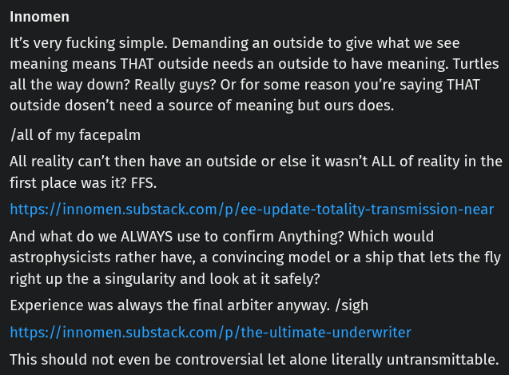

# EE Segment transcript

## Machine transcription

Innomen

It's very fucking simple. Demanding an outside to give what we see
meaning means THAT outside needs an outside to have meaning. Turtles
all the way down? Really guys? Or for some reason you're saying THAT
outside dosen’t need a source of meaning but ours does.

/all of my facepalm

All reality can't then have an outside or else it wasn't ALL of reality in the
first place was it? FFS.

https://innomen.substack.com/p/ee-update-totality-transmission-near

And what do we ALWAYS use to confirm Anything? Which would
astrophysicists rather have, a convincing model or a ship that lets the fly

right up the a singularity and look at it safely?
Experience was always the final arbiter anyway. /sigh
https://innomen.substack.com/p/the-ultimate-underwriter

This should not even be controversial let alone literally untransmittable.
