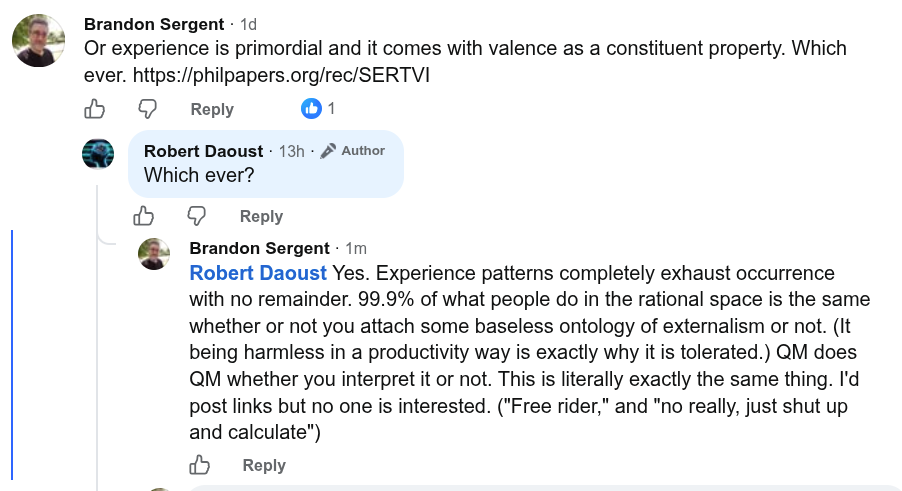

# EE Segment transcript

## Machine transcription

Brandon Sergent - 1d
Or experience is primordial and it comes with valence as a constituent property. Which
ever. https://philpapers.org/rec/SERTVI

5 & Reply [+ X

@  Rovert Daoust - 131+ 2 Author
Which ever?

@ & Reply

‘. Brandon Sergent - 1m
Robert Daoust Yes. Experience patterns completely exhaust occurrence
with no remainder. 99.9% of what people do in the rational space is the same
whether or not you attach some baseless ontology of externalism or not. (It
being harmless in a productivity way is exactly why it is tolerated.) QM does
QM whether you interpret it or not. This is literally exactly the same thing. I'd
post links but no one is interested. ("Free rider," and "no really, just shut up
and calculate")

>  Reply
