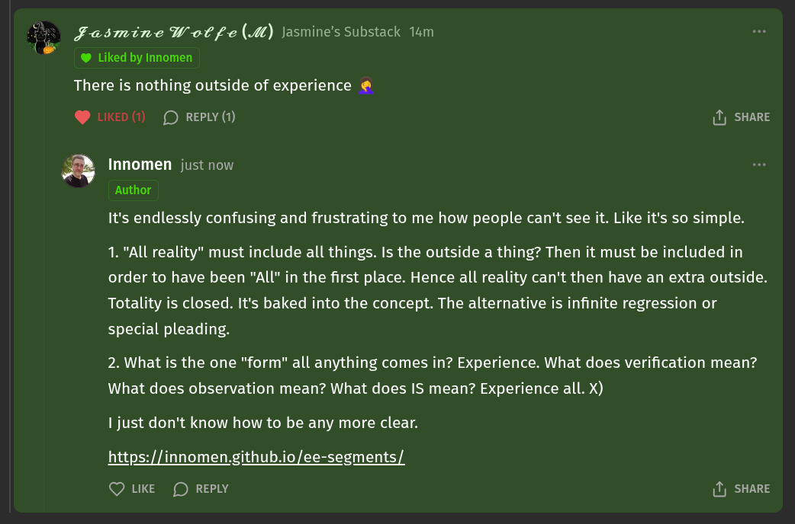

# EE Segment transcript

## Machine transcription

. Fasmine Wol fe (M) Jasmine's Substack 14m
{ &

@ Liked by Innomen

There is nothing outside of experience @

@ LIKED (1) (D REPLY (1) (1) SHARE

Innomen just now
Author

It's endlessly confusing and frustrating to me how people can't see it. Like it's so simple.

1. "All reality" must include all things. Is the outside a thing? Then it must be included in
order to have been "All" in the first place. Hence all reality can't then have an extra outside.
Totality is closed. It's baked into the concept. The alternative is infinite regression or
special pleading.

2. What is the one "form" all anything comes in? Experience. What does verification mean?
What does observation mean? What does IS mean? Experience all. X)

I just don't know how to be any more clear.

https://innomen.github.io/ee-segments/

Q LKE (D REPLY 1) SHARE
