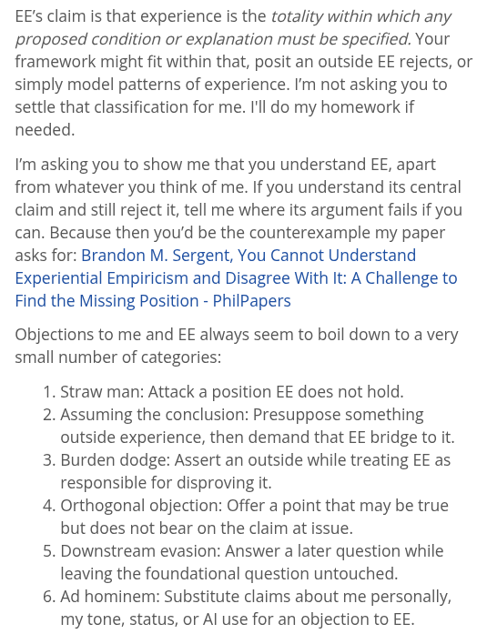

# EE Segment transcript

## Machine transcription

EE's claim is that experience is the totality within which any
proposed condition or explanation must be specified. Your
framework might fit within that, posit an outside EE rejects, or
simply model patterns of experience. I'm not asking you to
settle that classification for me. I'll do my homework if
needed.

I'm asking you to show me that you understand EE, apart
from whatever you think of me. If you understand its central
claim and still reject it, tell me where its argument fails if you
can. Because then you'd be the counterexample my paper
asks for: Brandon M. Sergent, You Cannot Understand
Experiential Empiricism and Disagree With It: A Challenge to
Find the Missing Position - PhilPapers

Objections to me and EE always seem to boil down to a very
small number of categories:

1. Straw man: Attack a position EE does not hold.

2. Assuming the conclusion: Presuppose something
outside experience, then demand that EE bridge to it.

3. Burden dodge: Assert an outside while treating EE as
responsible for disproving it.

4. Orthogonal objection: Offer a point that may be true
but does not bear on the claim at issue.

5. Downstream evasion: Answer a later question while
leaving the foundational question untouched.

6. Ad hominem: Substitute claims about me personally,
my tone, status, or Al use for an objection to EE.
