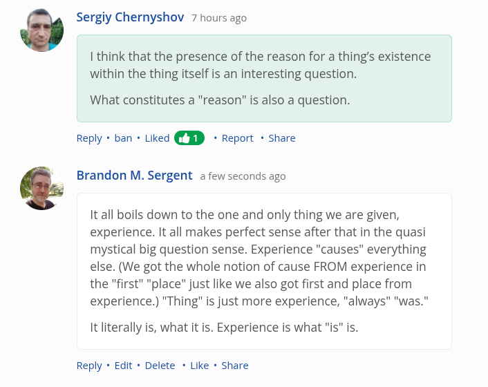

# EE Segment transcript

## Machine transcription

G Sergiy Chernyshov 7 hours ago

1 think that the presence of the reason for a thing's existence
within the thing itself is an interesting question.

What constitutes a "reason"” is also a question.

Reply + ban + Liked * Report + Share

& Brandon M. Sergent a few seconds ago

It all boils down to the one and only thing we are given,
experience. It all makes perfect sense after that in the quasi
mystical big question sense. Experience "causes" everything
else. (We got the whole notion of cause FROM experience in
the "first" "place” just like we also got first and place from
experience.) "Thing" is just more experience, "always" "was."

It literally is, what it is. Experience is what "is" is.

Reply + Edit « Delete * Like * Share
