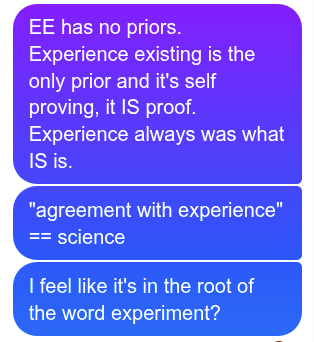

# EE Segment transcript

## Machine transcription

EE has no priors.
Experience existing is the
only prior and it's self
proving, it IS proof.
Experience always was what
IS is.

"agreement with experience"
== science

| feel like it's in the root of
the word experiment?
