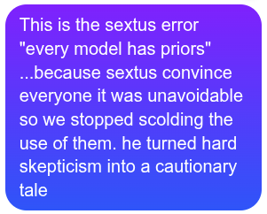

# EE Segment transcript

## Machine transcription

This is the sextus error
"every model has priors"
...because sextus convince
everyone it was unavoidable

so we stopped scolding the
use of them. he turned hard
skepticism into a cautionary
tale
